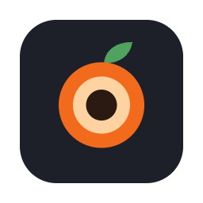

<p align="center" class="logo-section">

</br>


<p align="center">
🍊 A macOS screen recorder that zooms in on what you click.<br>
<br/>
<br/>

</p>
<p align="center">
<a align="center" href="https://halitsever.github.io/avora-screen-recorder/">Documentation</a>
  </p>
</p>

<p align="center">

</p>

- 🔍 [**Automatic zoom**](https://halitsever.github.io/avora-screen-recorder/#zoom) - every click zooms the video in on that spot, and the camera follows the area you work in.
- 🖱️ [**Smooth cursor**](https://halitsever.github.io/avora-screen-recorder/#zoom) - Avora draws the cursor itself, larger and with smoothed movement.
- 🎞️ [**Motion blur**](https://halitsever.github.io/avora-screen-recorder/#zoom) - zooms, pans and the cursor smear naturally within each frame.
- 🎙️ [**Sound**](https://halitsever.github.io/avora-screen-recorder/#using) - record your microphone and the Mac's audio; your voice is evened out on export.
- 🪟 [**Screen, window or area**](https://halitsever.github.io/avora-screen-recorder/#using) - record the whole display, one window or an area you drag out, and pause with ⌃⌥⌘P.
- 🎨 [**Backgrounds**](https://halitsever.github.io/avora-screen-recorder/#backgrounds) - twelve preset backdrops behind a screen with rounded corners and a soft shadow.
- 🧭 [**Menu bar first**](https://halitsever.github.io/avora-screen-recorder/#using) - start and stop recording from the menu bar, Avora's own window, or ⌃⌥⌘R in any app.
- ✂️ [**Zoom editor**](https://halitsever.github.io/avora-screen-recorder/#using) - move, resize, add and remove zooms, set their level or pin their focus, then export again.
- ⚙️ [**Export settings**](https://halitsever.github.io/avora-screen-recorder/#hood) - MP4, HEVC, ProRes or GIF, plus resolution, frame rate, quality, zoom level and the frame's look.
- 🛠️ [**Re-render**](https://halitsever.github.io/avora-screen-recorder/#install) - raw recordings are kept for 7 days, so you can render them again with another background.

<p align="center" >

</p>

Avora needs macOS 14 or later and Xcode 16 or later. Build the app and open it:

```sh
./scripts/build-app.sh
open build/Avora.app
```

The first recording asks for Screen Recording permission. Run the tests with `swift test`.

<p align="center" href="https://github.com/halitsever/avora-screen-recorder/issues">

</p>

<p align="center">

</p>

<p align="center">

</p>

<p align="center">
MIT. The Sora font in <code>Resources/Fonts</code> is under the SIL Open Font License.
</p>
